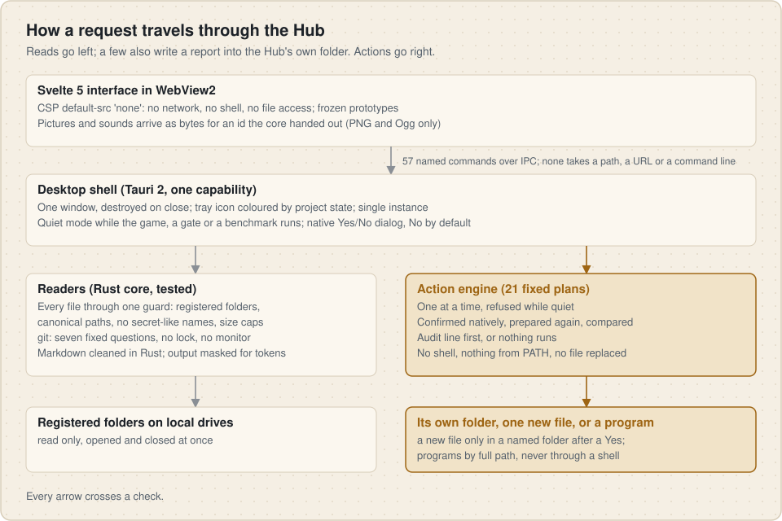
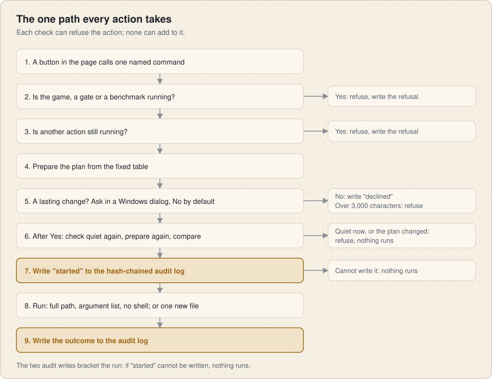

# Errastra Hub: engineering notes

A small Windows desktop app that lets me see the whole state of my game project in one window, and that is built so it can read almost anything but change almost nothing.

These are notes, not source. The Hub reads private project records, so its code stays private. What is here is how it is put together, what it measured, and what it deliberately does not do.

## At a glance

| | |
|---|---|
| What it is | A read-first dashboard for a one-person game studio: project status, hand-over notes from coding sessions, a searchable library of design documents, tasks and follow-ups, build and test history, backups, release readiness, an art review bench, an audio review bench and a launcher for test builds. |
| My part | I set the design and its rules in a written architecture document before any code, made every decision on scope and trade-offs, reviewed each phase's results and the findings of separate AI review agents, and approved each phase. Claude Code wrote most of the code (see "How this was made"). |
| Stack | Rust 1.94.1, Tauri 2.12.7 (with tauri-plugin-single-instance 2.5.5), Svelte 5.57.3, @tauri-apps/api 2.12.4, TypeScript 6.0.3, Vite 8.3.7, pulldown-cmark 0.12.2, ammonia 4.2.5, sysinfo 0.37.2. WebView2 on Windows. |
| Size | About 16,400 lines of Rust in the two crates' source folders, tests not counted (build 7). In the source at build 8: 290 Rust tests and 55 interface tests, counted on 25 November 2026. |
| Launch | Warm launches of build 8 took 249 to 336 ms from process start to window (25 November 2026). Its first launch after install took 711 ms, over the 500 ms budget; the record puts that down to a cold program file, which was not tested. Across the eight builds the recorded first figures ran from 0.42 to 0.71 s, and builds 1, 6 and 8 were over the budget. |
| In the tray | 7.9 MB private memory on build 8 (7.4 to 8.5 MB across all eight builds and their repeats), no web view process, 0% GPU, about 15.6 ms of processor time a minute. |
| Cost to the game | None that could be measured: 6.526 ms a frame without the Hub and 6.389 ms with it in the tray, over twelve runs at the monitor's native resolution and refresh rate (24 November 2026). |

## It reads by default

Almost everything the Hub does is reading. The core is a set of readers, each tested against fixture files, that turn Markdown, CSV, TOML, JSON and git output into the data each view shows. The views are generic: status, sessions and hand-over notes, the document library, tasks, build and test history, disk and worktrees, security, the art and audio benches, test builds, and a "waiting on you" inbox that collects every open question in one list.

Git is asked a fixed list of seven questions (worktree list, head, branch, status, last commit, unpushed count, tracked names). Every call is `git --no-optional-locks -c core.fsmonitor=false`, with a 10 second limit, so the Hub takes no lock, refreshes no index and never starts a file-system monitor in someone else's tree. There is no way to pass git any other subcommand.

The Hub also goes quiet while the game, a full test gate or a benchmark is running: no reading, no polling, no action, no sound. It looks at the process list as little as it can and asks the system drive alone for free space, because listing every volume twice a minute could wake a sleeping disk.

<picture>
  <source media="(prefers-color-scheme: dark)" srcset="diagrams/architecture-dark.svg">
  
</picture>

## The page is boxed in

The interface is a Svelte page inside WebView2. It is treated as the least trusted part of the app.

- **Content Security Policy.** The policy, as shipped:
  `default-src 'none'; script-src 'self'; style-src 'self'; font-src 'self'; img-src 'self' data:; connect-src ipc: http://ipc.localhost; form-action 'none'; base-uri 'none'`.
  Nothing inline, nothing remote, no forms. The page can talk to the Rust side and to nothing else.
- **Tauri settings.** `withGlobalTauri` is off and `freezePrototype` is on. The interface is always served from inside the exe; there is no dev server in the release build.
- **One capability.** The window gets exactly one capability, which lists the Hub's own commands and no Tauri plugin: no shell, no file system, no HTTP, no window or event APIs. There are 57 named commands. 36 read (a few of those write an exported report into the Hub's own folder) and 21 act. None of them takes a path, a URL or a command line.
- **Pictures and sounds.** They reach the page as bytes, for an id the core handed out earlier. Only PNG and Ogg files are handed out.
- **Documents are untrusted.** Markdown is rendered and cleaned in Rust before the page sees it: no scripts, styles, event handlers, forms or images, and a link to the outside world is shown as text, not something to click.
- **Program output is masked.** What a tool printed is filtered for token shapes before it is shown. A JSON answer is parsed first and only its string values are masked, so a key or a path is never eaten.
- **Supply chain.** The interface ships two runtime packages, `svelte` and `@tauri-apps/api`. Both lockfiles are frozen; npm install scripts are off; a package must be two weeks old before it can be installed. A test pins the dependency lists, the page's permissions and the three Windows libraries the exe links.

## How file reads are guarded

Every file the Hub opens goes through one function. A read is allowed only when all of these hold:

1. **The path is inside a registered folder.** Every folder the Hub may read is named in one settings file in the Hub's own data folder. It is checked on every start: each value must be a full path on a lettered local drive that climbs nowhere. Anything else (a network share, a device path, a relative path) is refused and shown in Settings, and the built-in default is used instead.
2. **The real path is checked, not the one asked for.** The path is canonicalised, Windows' `\\?\` prefix is removed so two paths compare, and the result must start with a canonicalised registered folder. A link that points outside is refused.
3. **The name does not look like a secret.** `.env` files, keys and certificates (`.pem`, `.key`, `.pfx`, `.p12`, `.ppk`, `.kdbx`, `.dpapi`), SSH private keys, `.netrc`, `.npmrc`, `.pypirc`, `.pgpass`, `credentials`, and any data file whose name contains a word like `password`, `secret` or `token` are refused. Templates and examples pass. The check runs on the name asked for and again on the real path.
4. **No folder on the way is a secret folder.** `.ssh`, `.aws`, `.gnupg` and the folder where my own secrets live are refused wherever they appear.
5. **Every read has a cap.** A small file up to 2 MB, a document up to 4 MB, a table up to 16 MB. A picture or sound is read whole or not at all: anything over 16 MB is refused, never cut. A log is read from its last bytes, starting at a whole line.

A file is opened, read and closed at once. Rust opens files on Windows with full sharing, so a reader never blocks another program's write, rename or delete.

Art records are the one exception to rule 3: a staged art piece's name comes from its content, and a sprite may well be called `token`. Those records go through a second entry point that keeps every folder rule and drops only the name rule. A review agent found this case before any real piece was affected.

## The single audited write path

The Hub has 21 actions. Each one is a fixed plan built in the Rust core: either a program, named by its full path, with a fixed argument list whose few holes are checked, or one new file in one named folder. Every action, without exception, goes through the same function.

<picture>
  <source media="(prefers-color-scheme: dark)" srcset="diagrams/write-path-dark.svg">
  
</picture>

In order:

1. If the game, a gate or a bench is running, the action is refused before anything is prepared, and the refusal is written down.
2. Only one action runs at a time. The core holds that lock, not the page.
3. The plan is prepared from the fixed table.
4. If the action changes anything that lasts, it is confirmed in a plain Windows message box drawn by Windows for the Hub's process, with No as the default button. The web page cannot answer it. A confirmation longer than 3,000 characters is refused rather than shown cut short.
5. After a Yes, quiet mode is checked again and the plan is prepared again. If what would now run differs in any way from what the dialog showed, nothing runs.
6. A "started" line is written to the audit log. If that line cannot be written, the action does not start.
7. The plan runs. A program is started by its full path with its arguments as a list: no shell in between, nothing looked up on PATH, so nothing typed can become a second command. A file is created new and never replaces one; its folder must resolve inside the named root, and the root itself must be a real folder where it says it is, not a link.
8. The outcome is written to the audit log. So is every refusal and every No.

The audit log is append-only JSON lines. Each line carries the SHA-256 of the line before it, and a separate head file holds the hash of the newest line. If the log no longer ends where the head file says, a warning line goes into the log itself before anything else is added. The Security view shows whether the chain holds.

The Hub never commits, merges, pushes, approves a test baseline or moves a version pin. No such action exists in the table.

## The tray, and what it costs

Closing the window destroys the web view. Only the small Rust process stays, with a tray icon whose colour is the project's state. That is why the tray figures are so much lower than the window figures.

Figures from the Hub's own measuring script, run on the installed exe after each phase:

| Build | Date | Launch to window | Second launch shows the window | Tray: private memory | Tray: working set | Window open: total private memory |
|---|---|---|---|---|---|---|
| Build 1 (Phase 1) | 23 Nov 2026 | 0.56 s | yes | 7.8 MB | 31 MB | not recorded |
| Build 2 (Phase 2) | 24 Nov 2026 | 0.50 s | 207 ms | 7.8 MB | 33.8 MB | 165.6 MB |
| Build 3 (Phase 3, PC busy compiling) | 24 Nov 2026 | 0.42 s; 0.29 to 0.77 s over four launches | 181 to 310 ms | 7.7 MB | 31.7 MB | 166.4 to 228.3 MB |
| Build 4 (merged main) | 24 Nov 2026 | 0.47 s | 149 ms | 7.9 MB | 31.8 MB | 182 MB |
| Build 5 (Phase 4) | 24 Nov 2026 | 0.50 s; 0.27 to 0.50 s over four launches | 125 to 141 ms | 7.9 MB | 32.0 MB | 171 to 212 MB |
| Build 6 | 24 Nov 2026 | 0.56 s (window handle after 0.30 s) | 494 ms | 7.6 MB | 29.2 MB | 207.7 MB |
| Build 7 | 25 Nov 2026 | 463 ms | 122 ms | 8.5 MB | 34.3 MB | 203.3 MB |
| Build 8 | 25 Nov 2026 | 711 ms first after install; then 336, 252 and 249 ms | 126 ms | 7.9 MB | 34.5 MB | 243.8 MB |

In every build the tray had no WebView2 process and used 0% GPU, and in each idle check the process used at most about 15.6 ms of processor time a minute. The budgets written into the measurement records were under 15 MB private and under 40 MB working set in the tray, and under 300 MB with the window open. The exe grew from 5.1 MB (build 1) to 6.3 MB (build 6).

Window memory moves by tens of megabytes between launches of the same screen. It belongs to WebView2 and is given back when the window closes.

**The game with the Hub in the tray.** On 24 November 2026, on a quiet PC, the game ran twelve times for 3,300 frames each at the monitor's native resolution and refresh rate, six times with the Hub in the tray and six without, in both orders. The means were 6.526 ms a frame without the Hub and 6.389 ms with it. That gap is smaller than the spread between runs of the same kind (6.15 to 6.73 ms), so the honest reading is "no measurable cost", not "faster". The game presents on vsync, so this test can show missed frames but not a cost smaller than one frame.

## What the review agents caught

Phases 1 to 4, the merge between them and build 6 were each reviewed by a separate AI agent (Claude, in a fresh context with no part in writing the code). I read every finding and approved what was done about it. The findings were fixed before the next phase, most with a test written first. A few examples:

- **A Yes could run during a gate.** In Phase 2 an action was prepared before the quiet check, and quiet was not checked again after the dialog. A Yes given just before a test gate started would have run during it. The action function now owns the whole sequence and checks again after the answer.
- **One wide character could close the app.** A long line with a multi-byte character at byte 4,000 made a string cut panic, and a release build aborts on a panic. The cut is now made on a character boundary; the test reproduces the old crash.
- **A link could escape the document view.** Raw HTML in a Markdown file could keep an outside link (`href="//host"`), reachable with a middle click. Now only in-page `#` links keep an `href`.
- **git status could start a program.** In a tree configured with a file-system monitor, `git status` would start it. Every git call now disables it.
- **A cut-short audit log could look intact.** The head record was overwritten by the next action, so a truncated log read as intact again after one click. A warning line is now written into the log first.

## What was traded off

- **Windows only.** The confirmation dialog is a Win32 message box and the app runs on WebView2. That was the right call for one PC, and it means none of this runs on Linux or macOS as written.
- **The audit log is evidence against accident, not against intent.** Someone who rewrites both the log and the head file with fresh hashes will not be caught. Nothing kept on the same disk by the same user can prevent that.
- **The guard works on names and folders.** A secret pasted into an ordinary document would be shown as written. Masking of program output is by shape, so a token inside a URL is shown.
- **A program stopped at its time limit does not take its children with it.** A started check has a Stop button but no time limit of its own.
- **Window memory is WebView2's.** 165 to 244 MB with the window open is the price of a web interface. The tray figures are low only because the web view is destroyed on close.
- **Heavy reads check quiet mode when they start, not while they run.**

## Not verified

- **A fresh cold-launch series.** The launch figures above are the recorded figure for each build, plus three series of four launches (builds 3, 5 and 8). A new series of cold launches needs the installed Hub closed first, so it is pending.
- **Screenshots.** The real Hub shows private project data, so none are published here. Screenshots are pending a build fed with fixture data. The diagrams stand in for them.
- **Phase 1's window memory** was not recorded.
- **The Phase 3 figures were taken while the PC was compiling** for another task, so they are figures on a busy machine.
- **The frame-pacing test cannot show a cost smaller than one frame.** The game's own per-frame benchmark needs a release build of the game's tests, which the Hub does not make.

## How this was made

Claude Code wrote most of the code under my direction. I set the design and its rules in a written architecture document before Phase 1, made the decisions, reviewed the results and approved each phase. A phase was called done only when its tests passed, the installed build had been measured, and the findings of a separate AI review agent had been fixed or written down with a reason, and I had read them and approved.

The Hub was built in a little under three days, in four phases and two follow-up rounds, alongside other work on the same PC. Its build script caps compiling at four jobs at below-normal priority and refuses to start while a game gate or benchmark runs.

Licence: all rights reserved (see LICENSE).
